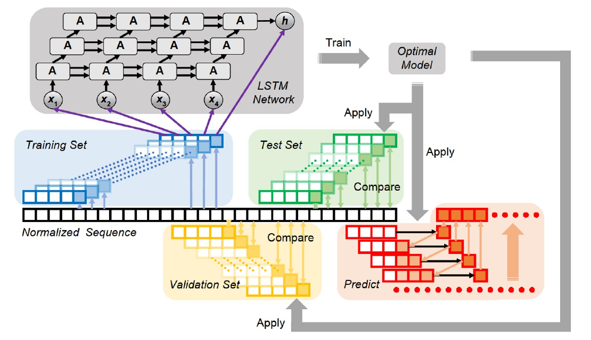
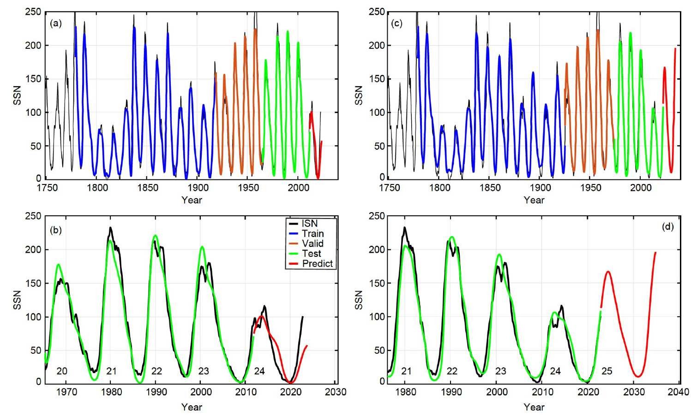
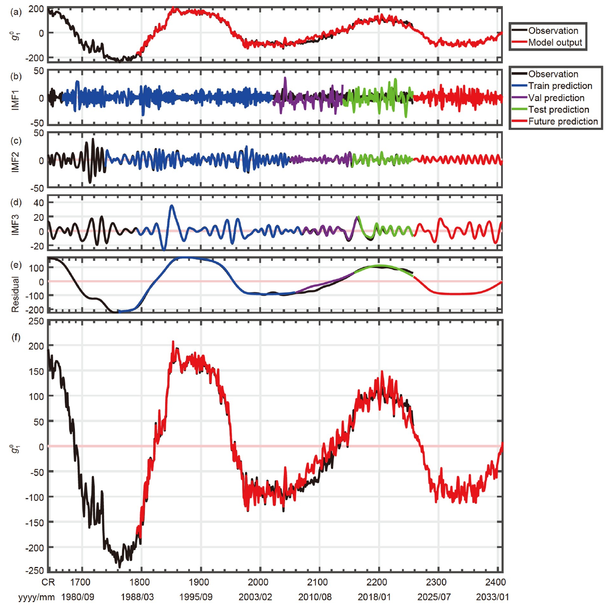
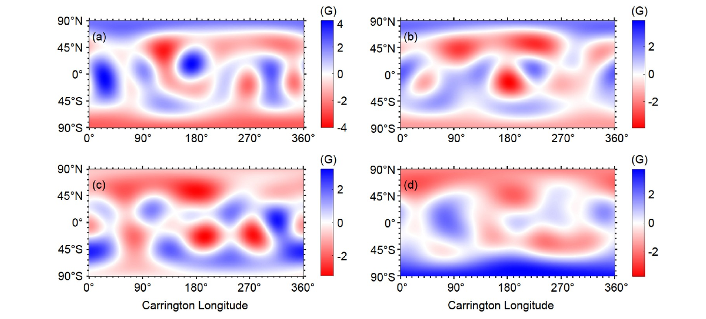
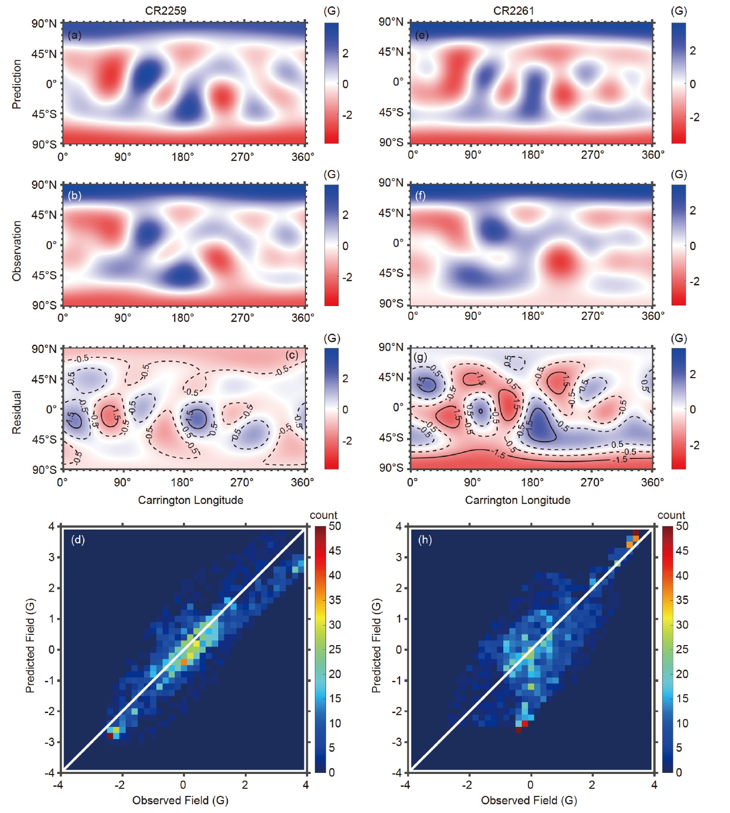

# Solar Activity and Synoptic-Map Prediction with LSTM and EMD

Research code for forecasting sunspot numbers and the large-scale photospheric magnetic field. The workflow separates spatial structure through spherical harmonics, models temporal evolution with Long Short-Term Memory (LSTM) networks and Empirical Mode Decomposition (EMD), and reconstructs low-order magnetic synoptic maps for Solar Cycle 25.

Associated article: **Rui Zhuo et al., “Prediction of solar activities: Sunspot numbers and solar magnetic synoptic maps,” Science China Earth Sciences 67(8), 2460–2477 (2024).** [English PDF](paper/Zhuo_et_al_2024_SCES.pdf) · [Chinese PDF](paper/Zhuo_et_al_2024_SSTe_CN.pdf) · [DOI: 10.1007/s11430-023-1354-4](https://doi.org/10.1007/s11430-023-1354-4)

## Scientific workflow

1. **Prepare observations.** Reformat WSO synoptic maps and spherical-harmonic tables, gather coefficient sequences by Carrington rotation (CR), and prepare SILSO sunspot-number records.
2. **Characterize temporal evolution.** Inspect coefficient time series, complex Morlet wavelet spectra, and phase relationships with sunspot activity to distinguish long-period evolution and intermittent disturbances.
3. **Predict sunspot numbers.** Train an LSTM on the 13-month smoothed monthly series, validate the model against historical intervals, and extend the sequence recursively over 144 months.
4. **Predict harmonic coefficients.** Decompose each selected coefficient into EMD components, train a separate LSTM for each component, and sum their forecasts. The published map prediction retains degrees l ≤ 5, corresponding to 36 signed-order coefficient series including l=0.
5. **Reconstruct and evaluate maps.** Assemble per-rotation harmonic tables, synthesize magnetic maps, and compare their polarity, residuals, and field correlations with observations. PFSS and externally computed SWMF products provide additional context for large-scale coronal and heliospheric applications.

### Key figures

These five figures are extracted from the supplied English publication PDF. They show the **published 2024 results**, including forecasts made at that time, rather than results regenerated during repository organization. Figure numbers follow the paper; see [figure provenance](figures/README.md).

**Figure 10 — From a time series to a recursive forecast.** Sliding windows, the training/validation/test stages, and iterative LSTM prediction connect the modeling steps.



**Figure 11 — Sunspot-number prediction.** Historical validation for Solar Cycle 24 and the original Solar Cycle 25 forecast show the temporal modeling component of the study.



**Figure 12 — EMD–LSTM coefficient prediction.** Separate forecasts of the intrinsic mode functions and residual combine into the axial-dipole coefficient forecast.



**Figure 14 — Predicted global magnetic maps.** Degree-five reconstruction turns the predicted time series into spatial distributions for selected Carrington rotations.



**Figure 15 — Comparison with observations.** Predicted maps, observed maps, residuals, and field-value distributions show the spatial validation at CR2259 and CR2261.



## Repository layout

```text
Synoptic_map_prediction_by_LSTM_EMD/   # Local Git checkout: CODE/
├── preprocess/                      # WSO/SILSO preprocessing
├── time_series_analysis/            # Coefficient and wavelet diagnostics
├── predict_sunspot_number/          # Sunspot LSTM variants and plots
├── predict_synoptic_map/            # EMD-LSTM, LSTM and exploratory models
├── plot_synoptic_map/               # Harmonic tables, maps and validation
├── postprocess_on_class/            # GONG-grid, PFSS and SWMF postprocessing
├── contribution_analysis/           # Magnetic-flux contribution diagnostics
├── determine_order/                 # Harmonic truncation comparisons
├── autoencoder_decoder/             # Experimental spatial compression
├── plot_cover/                      # Cover/presentation plots
├── archive/                         # Earlier EMD and Transformer prototypes
├── config/                          # Shared defaults and local template
├── src/smp/                         # Python configuration and utilities
├── tests/                           # Portable helper tests
├── figures/                         # Five paper figures and provenance
├── paper/                           # Supplied English and Chinese PDFs
├── references/paper.bib             # Downloadable BibTeX citation
├── docs/                            # Data, publication and organization notes
├── setup_matlab.m                   # MATLAB path setup
├── requirements.txt                # Pinned reconstruction environment
├── pyproject.toml                   # Python package and dependency ranges
└── CITATION.cff                     # GitHub citation metadata
```

The existing compact MAT/FITS/XLSX examples, checkpoints, and historical plots remain at their established paths to preserve script references. New `data/`, `outputs/`, checkpoints, and `config/local.json` are ignored. The complete external `RESULT` archive stays outside Git; [organization notes](docs/ORGANIZATION.md) record renamed and archived scripts.

## Requirements

- **Python 3.10 or 3.11** for the documented dependency set. Core workflows use NumPy, SciPy, pandas, Matplotlib, scikit-learn, PyTorch, EMD-signal (`PyEMD`), and PyWavelets; comparison scripts additionally use statsmodels and TensorFlow/Keras.
- **Solar postprocessing:** Astropy, SunPy, pfsspy, and openpyxl for FITS, PFSS, and external simulation spreadsheets.
- **MATLAB:** the scripts were maintained with R2022a available locally. JSON configuration requires `jsondecode`; plotting and analysis can require newer graphics functions. Wavelet diagnostics require Wavelet Toolbox, and statistical helpers can require Statistics and Machine Learning Toolbox. The complete MATLAB workflow has not been verified across releases.
- **External inputs:** WSO, SILSO, and optionally GONG/OMNI observations and precomputed SWMF products. SWMF itself is not bundled or invoked by this repository.

```bash
python -m venv .venv
# Windows: .venv\Scripts\activate
# Linux/macOS: source .venv/bin/activate
python -m pip install -r requirements.txt
python -m pip install -e . --no-deps
```

The pinned file is a reconstruction environment, not an archived record of the original 2024 training environment. Numerical reproduction requires matching the input versions, historical cutoffs, model settings, and hardware behavior.

## Data and configuration

Get observations from [WSO](http://wso.stanford.edu/#Synoptic), [SILSO](https://www.sidc.be/SILSO/datafiles), [NSO/GONG](https://gong.nso.edu/data/magmap/), and [NASA OMNI](https://omniweb.gsfc.nasa.gov/). Expected filenames, MAT variables, directory handoffs, and run limits are documented in [docs/DATA.md](docs/DATA.md).

Copy `config/local.example.json` to `config/local.json` and set `data_root` and `output_root`, or set `SMP_DATA_ROOT` and `SMP_OUTPUT_ROOT`. Defaults resolve to repository-local `data/` and `outputs/`; individual named paths can point to existing archives. Python also honors `SMP_RANDOM_SEED`; historical model-specific seeds remain explicit in `src/smp/constants.py` (EMD-LSTM: 789; original LSTM: 123; general default: 456).

From the repository root, install the Python package and prepare the required inputs before running:

```bash
python predict_sunspot_number/LSTM_for_sn_sm.py
python predict_synoptic_map/EMD/EMD_LSTM.py
```

The EMD-LSTM default runs only `lm=1`, holds out the last 141 CR samples, and has `save_or_not=0`. Select the coefficient range, historical cutoff, and export setting explicitly; generating all 36 degree-five series requires separate component training for each coefficient. Training writes a working-directory `best_model.pkl`, so run experiments sequentially or in separate working directories to avoid checkpoint collisions.

```matlab
run('setup_matlab.m')
% After all 36 forecast CSV files exist in cfg.paths.model_output:
run('plot_synoptic_map/neaten_predict_harmonic_coefficient.m')
% Set mode=2, cr_beg/cr_end, and save_or_not in the reconstruction script:
run('plot_synoptic_map/plot_synoptic_map_from_harmonic_coefficient.m')
```

The scripts retain interactive research settings. Some downstream plots need precomputed grids, workspace variables, or exports whose save statements are disabled; this is not a one-command reproduction. The 2024 forecasts shown above are historical study results and have not been updated against later observations.

### Verification

```bash
python -m compileall -q src archive autoencoder_decoder postprocess_on_class predict_sunspot_number predict_synoptic_map time_series_analysis
python -m unittest discover -s tests
```

The existing [CI workflow](.github/workflows/ci.yml) checks Python compilation and the shared utility tests. Full model training, map regeneration, and SWMF validation require external data and were not rerun during organization; see [validation notes](docs/VALIDATION.md).

## Code functionality

Each entry below describes one source file. Main workflows are listed first; comparison and archived scripts retain their experimental status.

### Observation preprocessing

| File | Functionality |
| --- | --- |
| [preprocess/neaten_WSO_photospheric_field.m](preprocess/neaten_WSO_photospheric_field.m) | Parses downloaded WSO text maps into numeric radial-field grids and longitude/latitude arrays. Edit the Carrington-rotation range and enable saving to populate the configured WSO field directory. |
| [preprocess/neaten_WSO_harmonic_coefficient.m](preprocess/neaten_WSO_harmonic_coefficient.m) | Converts WSO coefficient downloads into per-rotation four-column tables (l, m, cosine coefficient, sine coefficient). These tables supply the coefficient gathering and map reconstruction steps. |
| [preprocess/gather_harmonic_coefficients.m](preprocess/gather_harmonic_coefficients.m) | Assembles the per-rotation WSO tables into one time-series matrix, with degree and signed azimuthal order in its first two rows. Saving now writes both the historical ASCII table and the MAT file with the save_var key required by Python. |
| [preprocess/neaten_sunspot_number.m](preprocess/neaten_sunspot_number.m) | Interpolates monthly SILSO records onto the Carrington-rotation sampling grid. It exports ASCII/CSV products when enabled; the MAT inputs used by the sunspot models must be prepared separately. |

### Time-series diagnostics

| File | Functionality |
| --- | --- |
| [time_series_analysis/get_harmonic_coefficient_cwt.py](time_series_analysis/get_harmonic_coefficient_cwt.py) | Computes complex Morlet wavelet coefficients for selected harmonic time series with PyWavelets. The default selection is l=0 and the historical export statements are commented out, so select degrees and enable exports before using the MATLAB spectrum plotter. |
| [time_series_analysis/plot_harmonic_coefficient_variation.m](time_series_analysis/plot_harmonic_coefficient_variation.m) | Plots harmonic time series, wavelet spectra, average spectra, and phase relationships with sunspot activity. It consumes the gathered coefficient matrix and precomputed CWT products, with solar-cycle colors and polarity-reversal markers. |
| [time_series_analysis/plot_histogram_of_magnetograms.m](time_series_analysis/plot_histogram_of_magnetograms.m) | Compares field-value distributions in observed and reconstructed WSO/GONG magnetograms for a selected rotation. It expects previously prepared MAT grids and converts WSO field values to gauss for comparison. |

### Sunspot-number prediction

| File | Functionality |
| --- | --- |
| [predict_sunspot_number/LSTM_for_sn.py](predict_sunspot_number/LSTM_for_sn.py) | Trains a PyTorch LSTM on the unsmoothed sunspot-number MAT series and recursively extends it by 120 samples. It uses a 359-sample input window and optionally exports training, validation, test, and future predictions. |
| [predict_sunspot_number/LSTM_for_sn_sm.py](predict_sunspot_number/LSTM_for_sn_sm.py) | Trains the main sunspot forecasting variant on the 13-month smoothed monthly series using a 356-month input window. It forecasts 144 months recursively and can export the four prediction segments for the MATLAB plotter. |
| [predict_sunspot_number/LSTM_for_sn_look_forw.py](predict_sunspot_number/LSTM_for_sn_look_forw.py) | Explores a multi-output look-forward LSTM using the sunspot-number series. It uses a shorter input window and a configurable forecast block, providing an experimental alternative to the single-step recursive model. |
| [predict_sunspot_number/plot_sn_prediction.m](predict_sunspot_number/plot_sn_prediction.m) | Combines saved LSTM output segments with observed smoothed sunspot numbers to visualize the forecast. Its dev setting selects the historical forecast case, and the plot includes model-error diagnostics. |

### Harmonic-coefficient prediction and comparison models

| File | Functionality |
| --- | --- |
| [predict_synoptic_map/EMD/EMD_LSTM.py](predict_synoptic_map/EMD/EMD_LSTM.py) | Decomposes one selected spherical-harmonic series into EMD components and trains a separate PyTorch LSTM for each component. It sums their recursive forecasts and optionally writes 150-rotation g_l_m.csv sequences; the default lm range selects only one coefficient. |
| [predict_synoptic_map/EMD/EMD_prediction.py](predict_synoptic_map/EMD/EMD_prediction.py) | Tests a standalone EMD-based extrapolation without the main LSTM component. It evaluates a selected coefficient with several error metrics and plots a 150-step experimental extension. |
| [predict_synoptic_map/LSTM/LSTM_early_stopping.py](predict_synoptic_map/LSTM/LSTM_early_stopping.py) | Trains a coefficient LSTM with validation-based stopping and checkpoint restoration. It provides a direct, non-EMD comparison and recursively forecasts 120 steps from a 150-sample input window. |
| [predict_synoptic_map/LSTM/LSTM_original.py](predict_synoptic_map/LSTM/LSTM_original.py) | Preserves an early PyTorch coefficient-regression experiment with a two-sample look-back. It illustrates sliding-window preparation and fitted predictions rather than the final EMD-LSTM pipeline. |
| [predict_synoptic_map/LSTM/LSTM_mixed.py](predict_synoptic_map/LSTM/LSTM_mixed.py) | Explores interpolation, smoothing, and LSTM fitting for a selected harmonic coefficient. Its input window scales with the interpolation rate and its plotting and checkpoint settings are intended for manual experiments. |
| [predict_synoptic_map/LSTM/LSTM_keras.py](predict_synoptic_map/LSTM/LSTM_keras.py) | Implements an alternative coefficient LSTM using Keras and a short input window. It visualizes fitted training/test behavior as a framework comparison to the PyTorch scripts. |
| [predict_synoptic_map/LSTM/one2one/LSTM_one2one.py](predict_synoptic_map/LSTM/one2one/LSTM_one2one.py) | Explores an LSTM relationship between interpolated sunspot and harmonic-coefficient sequences. It requires both MAT products and restores a saved model before evaluating the fitted mapping. |
| [predict_synoptic_map/LSTM/plot_coefficient_prediction.m](predict_synoptic_map/LSTM/plot_coefficient_prediction.m) | Plots observed harmonic coefficients alongside stored model forecasts across multiple panels. It expects the historical per-coefficient forecast exports and uses a 150-rotation prediction interval. |
| [predict_synoptic_map/LSTM/plot_g_1_0_prediction.m](predict_synoptic_map/LSTM/plot_g_1_0_prediction.m) | Visualizes the axial-dipole coefficient forecast and its component prediction segments. It uses existing CSV exports to compare the observed series with the model output in a focused panel layout. |
| [predict_synoptic_map/final_plot_coefficient_prediction.m](predict_synoptic_map/final_plot_coefficient_prediction.m) | Builds a multi-panel summary of harmonic-coefficient forecasts from precomputed CSV products. It is a publication plotting step and does not train the models that produced those products. |
| [predict_synoptic_map/STL/STL.py](predict_synoptic_map/STL/STL.py) | Displays an additive seasonal decomposition of a selected harmonic time series. Despite the directory name, this script calls seasonal_decompose rather than the STL estimator. |
| [predict_synoptic_map/STL/STL_LSTM.py](predict_synoptic_map/STL/STL_LSTM.py) | Tests an LSTM forecast after seasonal/trend preprocessing of the selected coefficient. It retains experimental window lengths and checkpoint settings for comparison with the EMD-LSTM method. |
| [predict_synoptic_map/FFT/fft_prediction.py](predict_synoptic_map/FFT/fft_prediction.py) | Explores a Fourier representation of a selected coefficient using the gathered harmonic matrix. It plots the resulting spectral reconstruction as a baseline experiment. |
| [predict_synoptic_map/FFT/fft_prediction_1.py](predict_synoptic_map/FFT/fft_prediction_1.py) | Extends a Fourier-based coefficient reconstruction over a 150-step future interval. It supplies an experimental periodic baseline rather than the publication EMD-LSTM forecast. |
| [predict_synoptic_map/ARIMA/sarima_prediction.py](predict_synoptic_map/ARIMA/sarima_prediction.py) | Performs a SARIMA parameter-search demonstration on a synthetic pulse sequence. It does not read solar observations and is retained as an exploratory example rather than a validated scientific baseline. |
| [predict_synoptic_map/DFNN/godfrey_2017.py](predict_synoptic_map/DFNN/godfrey_2017.py) | Implements a dense neural-network time-series experiment with custom training and plotting helpers. It is retained as a comparison prototype and is separate from the main recurrent forecasting workflow. |
| [predict_synoptic_map/DFNN/godfrey_2017_marked.py](predict_synoptic_map/DFNN/godfrey_2017_marked.py) | Preserves an annotated version of the dense-network experiment and its custom loss. The additional historical comments explain the prototype architecture and training procedure. |
| [predict_synoptic_map/DFNN/godfrey_2017_modified.py](predict_synoptic_map/DFNN/godfrey_2017_modified.py) | Adapts the dense-network prototype to the configured sunspot-number MAT input. It trains and plots a comparison model without participating in the harmonic-map reconstruction chain. |
| [predict_synoptic_map/transformer/transformer_1dayprediction.py](predict_synoptic_map/transformer/transformer_1dayprediction.py) | Explores a Transformer-style network using the configured sunspot series. Its inherited day-prediction name and checkpoint format come from a prototype and should not be interpreted as a validated daily solar forecast. |
| [predict_synoptic_map/transformer/transformer_run1.py](predict_synoptic_map/transformer/transformer_run1.py) | Trains a Transformer prototype on external multivariate five-minute training and validation CSV files. Those inputs are not included, and this script is outside the published synoptic-map workflow. |

### Map reconstruction and validation

| File | Functionality |
| --- | --- |
| [plot_synoptic_map/neaten_predict_harmonic_coefficient.m](plot_synoptic_map/neaten_predict_harmonic_coefficient.m) | Collects the 36 signed-order coefficient forecasts through degree five into per-rotation four-column harmonic tables. It now reads the configured model_output directory and writes predicted_harmonics for reconstruction, starting at CR2259. |
| [plot_synoptic_map/plot_synoptic_map_from_harmonic_coefficient.m](plot_synoptic_map/plot_synoptic_map_from_harmonic_coefficient.m) | Reconstructs planar and spherical radial-field maps from WSO, GONG, or predicted harmonic coefficients. Set mode=2 and the desired rotation range for forecasts; Schmidt semi-normalization and the retained WSO unit conversion are explicit in the synthesis loop. |
| [plot_synoptic_map/plot_synoptic_map_from_WSO.m](plot_synoptic_map/plot_synoptic_map_from_WSO.m) | Plots observed WSO photospheric maps using the preprocessed field and coordinate arrays. It optionally exports the selected rotation maps to the configured output archive. |
| [plot_synoptic_map/plot_synoptic_map_from_GONG.m](plot_synoptic_map/plot_synoptic_map_from_GONG.m) | Loads GONG FITS magnetograms and displays their radial-field distribution. It provides observed-map context and optionally saves figures for the selected rotations. |
| [plot_synoptic_map/plot_residual_map.m](plot_synoptic_map/plot_residual_map.m) | Displays the difference between precomputed prediction and observation grids. It requires exported numeric maps; rendered PNG images alone are insufficient inputs. |
| [plot_synoptic_map/calculate_correlation_coefficient.m](plot_synoptic_map/calculate_correlation_coefficient.m) | Interpolates prepared prediction and observation grids onto a common longitude-latitude grid. It computes correlation and a linear fit and displays scatter and two-dimensional count distributions. |
| [plot_synoptic_map/compare_coefficients.m](plot_synoptic_map/compare_coefficients.m) | Compares predicted harmonic tables with observations and a CR2258 persistence baseline. It plots coefficient values and relative errors, using the same predicted_harmonics directory as the reconstruction workflow. |

### Solar and solar-wind postprocessing

| File | Functionality |
| --- | --- |
| [postprocess_on_class/interp_to_gong_grid.m](postprocess_on_class/interp_to_gong_grid.m) | Interpolates prepared WSO/predicted maps to a GONG-compatible grid. Its optional MAT export is consumed by the FITS conversion workflow and requires checking the selected rotation and orientation. |
| [postprocess_on_class/neaten_as_gong_data.py](postprocess_on_class/neaten_as_gong_data.py) | Replaces a GONG template image with an interpolated WSO map and updates image-statistics header fields. FITS writing is disabled by default, and time/rotation metadata must be checked before exporting a new product. |
| [postprocess_on_class/pfss.py](postprocess_on_class/pfss.py) | Computes a potential-field source-surface solution with pfsspy for a configured GONG map. It displays source-surface polarity and traced field lines using 30 radial cells and a source surface at 2.5 solar radii. |
| [postprocess_on_class/plot_swmf_source_surface_map.py](postprocess_on_class/plot_swmf_source_surface_map.py) | Compares externally produced SWMF source-surface grids with PFSS results from observed GONG maps. It requires local simulation spreadsheets and produces comparison figures; it does not run the SWMF simulation itself. |
| [postprocess_on_class/magnetic_including_angle.m](postprocess_on_class/magnetic_including_angle.m) | Compares magnetic-field directions in external SWMF outputs and OMNI observations near Earth. It reads precomputed spreadsheets and plots directional diagnostics rather than performing a solar-wind simulation. |

### Supporting analyses and illustrations

| File | Functionality |
| --- | --- |
| [contribution_analysis/calculate_magnetic_flux_contribution_in_AR.m](contribution_analysis/calculate_magnetic_flux_contribution_in_AR.m) | Explores the contribution of active-region fields to the harmonic representation of solar magnetograms. It retains alternative region-selection methods and local helpers for map reconstruction and magnetic-flux calculations. |
| [contribution_analysis/plot_harmonic_coefficient_distribution.m](contribution_analysis/plot_harmonic_coefficient_distribution.m) | Visualizes the distribution and relative importance of spherical-harmonic coefficients. It supplies supporting diagnostics for selecting a low-order representation of the global solar field. |
| [determine_order/plot_source_surface_of_different_order.m](determine_order/plot_source_surface_of_different_order.m) | Compares precomputed PFSS source-surface maps from degree-five, degree-nine, and GONG boundary conditions. It plots their spatial distributions and computes correlation diagnostics for the truncation study. |
| [autoencoder_decoder/autoencoder.py](autoencoder_decoder/autoencoder.py) | Trains a dense autoencoder on normalized 30-by-73 WSO maps and inspects reconstructions and latent variables. This exploratory spatial compression model is independent of the paper EMD-LSTM method. |
| [plot_cover/plot_sn_series_cover.m](plot_cover/plot_sn_series_cover.m) | Creates a presentation-style plot of historical and predicted sunspot numbers. It uses stored forecast CSV files and the specifically named SILSO monthly files selected in the script. |
| [plot_cover/plot_solar_wind_pressure_cover.m](plot_cover/plot_solar_wind_pressure_cover.m) | Plots the relationship between 27-day OMNI solar-wind pressure and smoothed sunspot activity. It retains local calendar-conversion helpers and requires the dated SILSO file selected in the script. |

### Configuration, utilities and tests

| File | Functionality |
| --- | --- |
| [setup_matlab.m](setup_matlab.m) | Adds the repository and its analysis subdirectories to the MATLAB search path. Run it once from the CODE root before calling scripts that use project_config. |
| [config/project_config.m](config/project_config.m) | Loads shared JSON defaults, local overrides, and the MATLAB data/output root environment variables. It resolves named paths for MATLAB scripts so the local data archive can remain outside the checkout. |
| [src/smp/__init__.py](src/smp/__init__.py) | Defines the lightweight Python package entry point and version metadata. Install the repository in editable mode to make its configuration and utilities available to research scripts. |
| [src/smp/config.py](src/smp/config.py) | Resolves shared paths and random-seed settings from defaults, an optional local file, an explicit override file, and environment variables. Named paths under data/ and outputs/ follow their corresponding configured roots. |
| [src/smp/constants.py](src/smp/constants.py) | Centralizes Carrington/year conversion constants, model-specific historical random seeds, and PFSS defaults. The EMD-LSTM and original LSTM seeds are retained separately from the configurable general seed. |
| [src/smp/utils.py](src/smp/utils.py) | Provides random-seed setup, centered smoothing, file checks, and min-max normalization. Optional deep-learning imports allow the portable utilities to be used with a smaller environment. |
| [tests/test_utils.py](tests/test_utils.py) | Checks default path resolution, normalization, moving-average length, and missing-file errors. These lightweight tests validate shared helpers and do not reproduce the scientific training or paper figures. |

### Archived experiments

| File | Functionality |
| --- | --- |
| [archive/emd/emd_lstm_prototype.py](archive/emd/emd_lstm_prototype.py) | Preserves the earlier EMD-LSTM copy previously named EMD_LSTM - 副本.py. It is retained for provenance, with the maintained coefficient-specific workflow located in predict_synoptic_map/EMD/EMD_LSTM.py. |
| [archive/transformer/transformer_1dayprediction.py](archive/transformer/transformer_1dayprediction.py) | Preserves the original Transformer prototype using external multivariate five-minute CSV inputs. It is archived for comparison and is not an entry point for the paper results. |
| [archive/transformer/transformer_run1.py](archive/transformer/transformer_run1.py) | Preserves the original Transformer training experiment and checkpoint conventions. Its external data contract is separate from the solar harmonic-coefficient forecast inputs. |

## Related publication and citation

- **English article:** [Public PDF in this repository](paper/Zhuo_et_al_2024_SCES.pdf) · [Publisher/DOI](https://doi.org/10.1007/s11430-023-1354-4).
- **Chinese counterpart:** [Public PDF in this repository](paper/Zhuo_et_al_2024_SSTe_CN.pdf) · [DOI: 10.1360/N072023-0305](https://doi.org/10.1360/N072023-0305).
- **Citation files:** [BibTeX](references/paper.bib) · [CITATION.cff](CITATION.cff).

The supplied publisher-formatted PDFs are included at the author’s request. Article and figure copyright remains with the respective rights holders; public availability is not an open-content license. See [publication provenance](paper/README.md).

### MLA

Zhuo, Rui, et al. “Prediction of Solar Activities: Sunspot Numbers and Solar Magnetic Synoptic Maps.” *Science China Earth Sciences*, vol. 67, no. 8, 2024, pp. 2460–2477. https://doi.org/10.1007/s11430-023-1354-4.

### BibTeX

```bibtex
@article{Zhuo2024SolarActivityPrediction,
  author  = {Zhuo, Rui and He, Jiansen and Duan, Die and Lin, Rong and Wu, Ziqi and Yan, Limei and Wei, Yong},
  title   = {Prediction of solar activities: Sunspot numbers and solar magnetic synoptic maps},
  journal = {Science China Earth Sciences},
  year    = {2024},
  volume  = {67},
  number  = {8},
  pages   = {2460--2477},
  doi     = {10.1007/s11430-023-1354-4},
  url     = {https://doi.org/10.1007/s11430-023-1354-4}
}
```

## Acknowledgments

We thank the Royal Observatory of Belgium/SILSO and Wilcox Solar Observatory for the original observations, and acknowledge NSO/GONG and NASA OMNI for the additional data used by supporting workflows. We thank B. B. Karak for the background of Figure 9 in the paper, and Jingxiu Wang, Jie Jiang, and Linhua Deng for helpful discussions.

The published work acknowledges the National Natural Science Foundation of China (42241118, 42174194, 42150105, 42204166, 42241106, 42074207), the National Key R&D Program of China (2021YFA0718600, 2022YFF0503800), and CNSA (D050106). Limei Yan also acknowledges the Youth Innovation Promotion Association of the Chinese Academy of Sciences (2021064).

The implementation uses the scientific Python, PyTorch, TensorFlow/Keras, PyWavelets, EMD-signal, SunPy, and pfsspy ecosystems alongside MATLAB. No software license has been selected for this repository; the original data and third-party components retain their respective terms.
